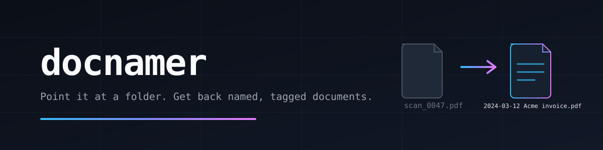

<p align="center">
  
</p>

# docnamer

Point it at a folder of scans and letters. Get files named the way you would have named them.

`scan_0047.pdf` becomes `2024-03-12 Acme Services invoice INV-2024-0817.pdf`. Finder gets a tag and a comment, so you can find it later. Nothing is renamed until you have seen the plan, and every run can be undone.

> **macOS only.** docnamer runs on macOS and nothing else. It reads scans with the Vision OCR framework and writes Finder tags and comments through `osascript`, `xattr` and `plutil` — all of which ship with macOS and none of which exist on Linux or Windows. There is no Windows or Linux build, and the code does not check the platform: the build calls `codesign`, reading a scan runs a macOS Vision binary, and tagging calls `osascript`, so on another system it fails at the first of those. No machine other than this Mac has run it.

## Start

From this repo, build it with [Bun](https://bun.sh), then sign in to a model provider.

```sh
bun run build
docnamer login
docnamer plan ~/Documents/unsorted
docnamer review ~/Documents/unsorted
docnamer apply ~/Documents/unsorted
```

`bun run build` installs the `docnamer` command at `~/bin/docnamer`.

| Command | What you get |
| --- | --- |
| `plan` | A plan for the folder. Renames nothing. |
| `review` | Accept, edit, or skip each file. Uncertain ones come first. |
| `apply` | Renames the accepted files, tags them, and writes an undo file. |
| `undo` | Puts the last run's names back. |

```sh
docnamer undo ~/Documents/unsorted
docnamer undo --run .docnamer-undo-2026-05-04T12-30-00-000Z.json ~/Documents/unsorted
```

Without `--run`, undo takes the most recent run in the folder. With it, undo takes the run file you name — the names `apply` wrote into `.docnamer-undo-<timestamp>.json`.

Include subfolders with `docnamer plan --recursive ~/Documents/unsorted`.

## What a plan looks like

```text
▰▰▰▰▰▰▰▰▰▰ 100% planned 2 document(s)
  OLD              NEW                                     TYPE     FLAGS
  ───────────────  ──────────────────────────────────────  ───────  ─────────────────────────────
! dup-invoice.txt  2024-02-04 Globex invoice GLX-0091.txt  invoice  missing required field number
  receipt.png      2024-03-12 Acme Services receipt.png    receipt
plan written to ~/Documents/unsorted/.docnamer-plan.json — run `docnamer review`
```

A `!` in the margin marks a row the program is not sure about, with the reason in FLAGS. Review shows those first, and you can change the name before anything is applied. On a narrow screen FLAGS gives way first, then the names truncate — the table never wraps a row onto two lines.

## What it reads

PDF, scans and photos, Word, Excel, PowerPoint, Pages, and plain text. Text comes from the file when the file has any. A scan is read on the Mac. A model is asked only for what the file does not already say, and the program checks the date and the name before they are used.

Invoices, receipts, statements, payslips, bills, tax, insurance, contracts, letters, tickets, and the rest of ordinary paperwork each get their own name. Anything that fits none of those is still named, from its date and title.

## Configuring a folder

Copy this repo's `docnamer.json` into the folder and edit the copy. A folder carrying that file is planned by that file **alone**: it replaces the built-in set, it does not merge with it. Write a three-line config and every type you left out is gone. A folder carrying no `docnamer.json` uses the built-in set, which is this same file compiled into the binary.

| Key | What it sets |
| --- | --- |
| `defaults` | `date_format`, `date_order` (`day-first` or `month-first`), `max_name_length`, and three switches: `ocr_text_layer` (write a text sidecar beside a scan), `finder_tags`, `finder_comment` |
| `models` | Three model ids: `cheap` reads text, `vision` reads scans and photos, `strong` takes a second look when the first reply could not be read |
| `types` | One entry per document type — the part you edit to change naming |
| `entities` | Company names, each with the spellings that mean it |
| `self` | The companies that are yours, so an invoice you issued is named after its customer |

A type is four keys:

```json
"receipt": {
  "describe": "Proof of payment after a purchase.",
  "template": "{date} {vendor} receipt",
  "fields": {
    "date": { "kind": "date", "required": true },
    "vendor": { "kind": "entity", "required": true }
  }
}
```

`describe` is the sentence the model reads to decide the type. `template` is the name: `{field}` becomes that field's value, everything outside braces is literal. `fields` declares what gets read, and `kind` says how it is cleaned before it names anything — `date` into your `date_format`, `entity` into the canonical spelling in `entities`, `last4` down to four digits, `text` as it came. A `required` field the document does not carry flags the row instead of naming it wrongly.

`counterparty` on an entity field names which other field takes over when this one is a company of yours: an invoice's `issuer` gives way to its `customer`, so the invoice you sent is named after who you sent it to. `self` holds those companies; `entities` holds everyone else's spellings.

Adding a type is one more entry under `types`, plus any new company spellings under `entities`.

## Also

`docnamer eval <testset>` scores a folder against an expected list and renames nothing. `docnamer auth` says where each provider key came from. `docnamer logout` removes a key this program stored.

## Credits

Built on [pi](https://github.com/earendil-works/pi) (`pi-tui` for the screen, `pi-ai` for the model providers) and [mac-ocr](https://github.com/privatenumber/mac-ocr) by Hiroki Osame for the Vision OCR that reads scans.

## License

[MIT](LICENSE) © 2026 Knosey
