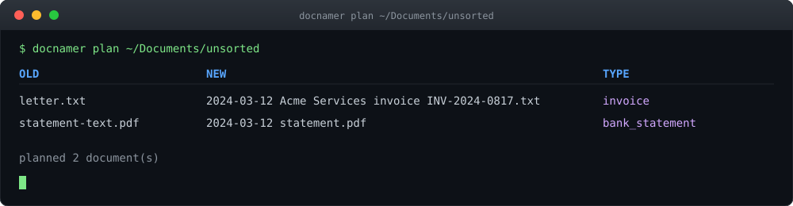

<p align="center">
  
</p>

<p align="center">
  
  
  
  
</p>

**docnamer reads one folder of documents, classifies each file with one model call, extracts that type's fields, and renames the files in place — with Finder tags and comments, and a full undo.**

Point it at a pile of `scan_0047.pdf` and `letter.txt`; get back `2024-03-12 Acme Services invoice INV-2024-0817.pdf`. Nothing is renamed until you have seen the plan, and every run is reversible.

## Quickstart

```sh
# Build the single-file binary (~68 MB, macOS built-ins only) into ~/bin/docnamer
bun run build

# Hand it your model credential
export FIREWORKS_API_KEY=…

# Plan a folder — renames nothing, shows the table
docnamer plan ~/Documents/unsorted

# Review row by row, then apply
docnamer review ~/Documents/unsorted
docnamer apply ~/Documents/unsorted
```

## The five commands

| Command | What it does |
| --- | --- |
| `docnamer plan [--recursive] <folder>` | Classifies and names every document, writes `<folder>/.docnamer-plan.json`. **Renames nothing.** |
| `docnamer review <folder>` | Interactive per-row pass over the plan: accept, edit, retype, skip. |
| `docnamer apply <folder>` | Performs the accepted renames and sets the Finder tag and comment. Writes an undo file. |
| `docnamer undo [--run <file>] <folder>` | Restores the original names from the run record. |
| `docnamer eval <testset>` | Scores a test set against its `expected.yaml`. **Renames nothing.** |

## What a run looks like

<p align="center">
  
</p>

```text
$ docnamer plan ~/Documents/unsorted
OLD                  NEW                                               TYPE
letter.txt           2024-03-12 Acme Services invoice INV-2024-0817.txt  invoice
statement-text.pdf   2024-03-12 statement.pdf                            bank_statement
planned 2 document(s)
```

## Reads what you actually have

| Format | How it's read |
| --- | --- |
| PDF with a text layer | Text pulled straight from the file |
| Scanned PDF, PNG, JPEG, TIFF | Apple Vision OCR; page images go to the vision model only when OCR is weak |
| DOCX, DOC, RTF | `textutil` |
| XLSX, PPTX, Pages | Unzipped, then the XML or QuickLook text extracted (`unzip`) |
| `.txt`, `.md`, `.csv` | Read as-is |

Runtime dependencies are macOS built-ins: Apple Vision OCR plus `sips`, `textutil`, `plutil`, `xattr`, `mdls`, `brctl`, `unzip`. iCloud placeholders are downloaded first with `brctl`.

## Document types

Sixteen types ship in `docnamer.json`, each with a plain-English description, its fields, and its own name template:

| Type | Template | Type-specific fields |
| --- | --- | --- |
| `invoice` | `{date} {issuer} invoice {number}` | date, issuer, number |
| `receipt` | `{date} {vendor} receipt` | date, vendor |
| `bank_statement` | `{date} {bank} statement {last4}` | date, bank, last4 |
| `payslip` | `{date} payslip {employer}` | date, employer |
| `utility_bill` | `{date} {provider} utility bill` | date, provider |
| `tax_document` | `{date} tax {form}` | date, form |
| `insurance_policy` | `{date} {insurer} policy {number}` | date, insurer, number |
| `contract` | `{date} contract {party}` | date, party |
| `letter` | `{date} {sender} letter {subject}` | date, sender, subject (optional) |
| `medical_letter` | `{date} medical {clinic}` | date, clinic |
| `prescription` | `{date} prescription {prescriber}` | date, prescriber |
| `boarding_pass` | `{date} boarding pass {flight}` | date, flight |
| `ticket` | `{date} ticket {event}` | date, event |
| `warranty` | `{date} warranty {product}` | date, product |
| `government_letter` | `{date} government {agency}` | date, agency |
| `other` | `{date} {title}` | date, title (both optional) |

Every type requires `date` except `other`, the fallback of last resort. Field kinds are `text`, `date`, `entity` and `last4` — each with its own normaliser, so `BARCLAYS BANK PLC` becomes `Barclays` and a date becomes `YYYY-MM-DD`, whatever the document printed.

## Configuration

One file, `docnamer.json`, holds the whole behaviour. Drop it in the folder being planned and it replaces the roster the binary was built from.

```json
{
  "defaults": { "date_format": "YYYY-MM-DD", "date_order": "day-first", "max_name_length": 120 },
  "models":   { "cheap": "…", "vision": "…", "strong": "…" },
  "types":    { "invoice": { "describe": "…", "template": "{date} {issuer} invoice {number}", "fields": { … } } },
  "entities": { "Barclays": ["Barclays Bank UK PLC", "Barclays Bank", "BARCLAYS"] }
}
```

- The `describe` strings **are** the prompt — tuning the tool mostly means editing this file.
- The `entities` table maps aliases to one canonical name, so names stay consistent across banks, utilities and insurers.
- A folder without its own `docnamer.json` is planned by the built-in roster.

## How it works

Four stages per file, then one command that touches anything:

1. **Read, cheapest first.** PDF text layer → Apple Vision OCR → page images to the vision model, only when OCR is weak. Text is capped at 4000 characters.
2. **Classify and extract in one call.** One model call returns the type, that type's fields, and the verbatim `evidence` each value came from — so invented values are caught in code.
3. **Validate and normalise.** Code, not the model, has the last word on dates, entities and names. Doubtful rows are flagged for review, never silently accepted.
4. **Build the name.** The type's template is filled, empty parts dropped, the result sanitised, shortened and made unique in its folder.
5. **Plan, review, apply, undo.** Stages 1–4 only write a plan file. `apply` is the one step that touches your files; `undo` restores from the run record.

Plan and undo files are plain JSON you can delete. There is no database, no library, no background process.

## Model tiers

| Tier | Model | Used for |
| --- | --- | --- |
| `cheap` | `fireworks/…/deepseek-v4p1-flash` | Text-only calls |
| `vision` | `fireworks/…/qwen3p8-max` | Calls that carry page images |
| `strong` | `fireworks/…/kimi-k3` | The heavy end of the roster |

Model calls go through `@earendil-works/pi-ai` with the credential from `FIREWORKS_API_KEY`. Most files never reach a vision model — real text comes from the file itself or from local OCR.

## Testing

80 passing, 0 failing, across 22 test files.

```sh
bun test        # runs the suite — note: it makes paid model calls
bun run build   # compiles src/cli.ts to ~/bin/docnamer
```

`docnamer eval <testset>` scores a folder of real documents against its `expected.yaml` — type accuracy, per-field match, full-name match — and renames nothing.

## License

[MIT](LICENSE) © 2026 Knosey
