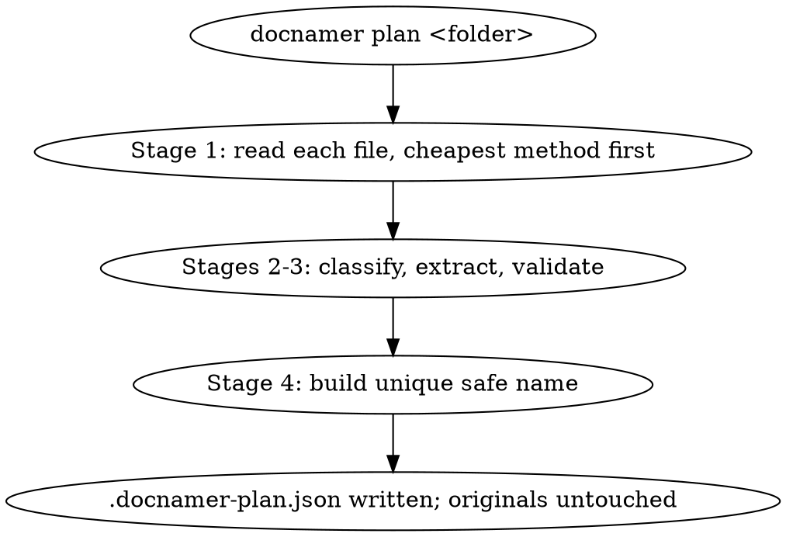
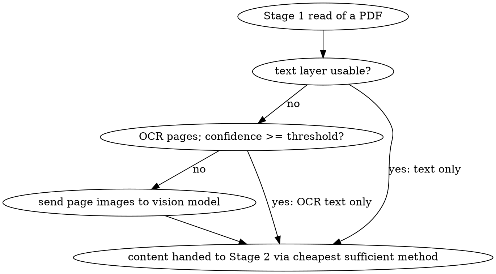
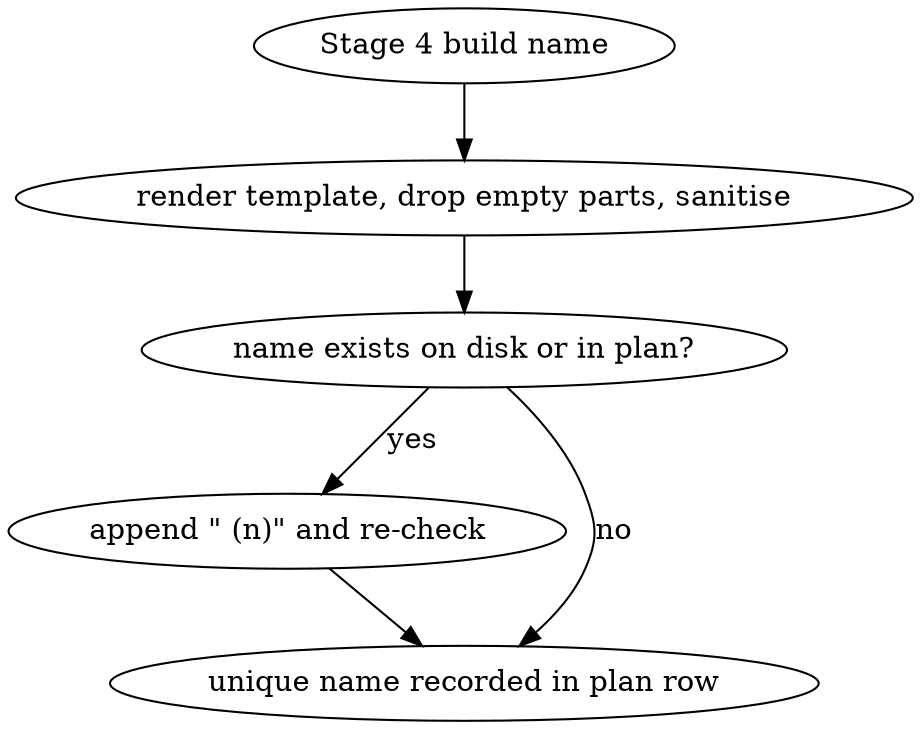

# 0002. A folder is planned from the cheapest sufficient read, and nothing is renamed

- Status: accepted
- Date: 2026-11-05

## Context

The first half of docnamer (0001): a folder of scans and letters becomes a plan of old names and
proposed new ones, with every original file left exactly as it was. This feature ends at a working
`plan`; `apply`, `undo`, `review`, `eval` and the install step are 0003, which requires this one.

Three constraints come from 0001 and are binding here rather than open: one bundled binary, native
Bun APIs only, and all model calls through `@earendil-works/pi-ai` (1.5.0) with no hand-rolled
provider layer.

The operator's folder holds real paperwork, so this half is where a name can be wrong expensively
later. Three forces decide the design. Cost and privacy: most files never need a vision model, and
the reading ladder exists so that real text comes from the file itself or from the Mac before any
image is sent anywhere. Determinism: a model that reads the page is not trusted with what code can
decide, so dates, entities and the rendered name are settled in code, and a doubtful value is
flagged for review rather than silently accepted. Seeing the plan is not changing the files: this
half writes one plan file into the folder and touches nothing else.

## Decision

`plan` reads the folder, works each file through four stages — read, classify-and-extract,
validate, name — and writes one plan file with a row per file. No original file's name, contents,
size or modification time changes.

- R1: One JSON config file, `docnamer.json`, holds all behaviour: document types with a plain
  English `describe`, per-type fields with kinds (`text`, `date`, `money`, `entity`, `last4`) and a
  `required` flag, per-type name templates, defaults (`date_format`, `date_order`,
  `max_name_length`, `ocr_text_layer`, `finder_tags`, `finder_comment`), an entity alias map, and
  the model split (a cheap model id for text-only calls and a vision model id for calls carrying
  images).
- R2: The shipped roster covers the common document types of a home and a work machine — a
  superset of invoice, bank statement, letter, receipt, tax form, payslip, contract, insurance
  policy, utility bill, medical, warranty, ID document, certificate and manual — plus `other`,
  which is always present as the fallback.
- R3: All model calls, classification and extraction, text and vision, go through
  `@earendil-works/pi-ai` (1.5.0), imported and connected through that library. The provider is
  cloud-first and vision-capable.
- R4: Reading is a ladder, cheapest first: direct text extraction for txt, md, docx, xlsx, pptx and
  pages; a PDF's text layer when it is usable (at least 200 mostly-word characters); otherwise page
  rendering (at most 3 pages, 200 dpi) and OCR; the vision model only when OCR is weak (under 200
  characters or mean confidence under 0.6). Extracted text is capped at 4000 characters, and iCloud
  placeholders are downloaded before anything reads them.
- R5: PDF text, page rendering and OCR use Apple-native tooling where possible: macOS Vision for
  OCR, built-in tools for a PDF's text.
- R6: One model call per file returns the type, its confidence, exactly that type's fields, a
  quote of the words each value came from, and a summary of at most twenty words — the comment
  `apply` writes later. Structured output where the provider has it, otherwise JSON validated in
  code with one repair retry and then a failed row. Text-only calls use the cheap model; calls
  carrying images use the vision model.
- R7: Validation is code-side: low type confidence (under 0.6), a missing required field, a value
  whose quote is not found in the extracted text, and an implausible date (unparseable, more than
  60 days ahead, or before 1980) are all flagged. An entity is canonicalised through the alias map
  with legal suffixes tidied off, and a `last4` field keeps only its last four digits. A missing
  required field is flagged and its slot dropped from the name; the type the model read is kept.
- R8: A slashed date is read day-first (03/04/2026 is 3 April 2026), from `date_order` in the
  config, never guessed.
- R9: The name comes from the type's template: empty parts dropped cleanly, filesystem-unsafe
  characters removed, the result shortened to `max_name_length` with `subject` and `number` cut
  first, the extension lowercased, and collisions resolved with Finder-style ` (2)` and ` (3)`
  suffixes against both the folder and the plan being written.
- R10: `plan <folder>` writes the plan file into the folder — a row per file with old name,
  proposed new name, type, fields, quotes, flags, summary, size, modification time and status
  `pending` — prints the old-to-new table with flagged rows first, and takes `--recursive` and
  `--apply-unflagged`.
- R11: `plan` renames, moves and rewrites nothing. The plan file is plain JSON the operator can
  delete. There is no database, no library of renamed files and no background process.

### I1: Plan a folder of documents without touching files

- Outcome: running `docnamer plan <folder>` on a folder of mixed documents writes
  `<folder>/.docnamer-plan.json` containing a row per file with old name, proposed new name, type,
  fields, evidence quotes, flags, summary, size, mtime and status "pending", prints the old-to-new
  table with flagged rows first, and leaves every original file's name, size and mtime unchanged.

### I2: Vision fallback only when OCR is weak

- Outcome: for a scanned PDF whose OCR text is under the confidence threshold, the plan row is
  produced from a vision-model call over page images, while a PDF with a usable text layer is
  planned from text alone with no image sent to the model.

### I3: Collision-safe unique naming

- Outcome: when two documents in the same folder, or one document and an existing file, render the
  same name, the later plan row receives a Finder-style ` (2)` suffix, and no plan row ever
  proposes a name already occupied on disk.

## Alternatives considered

- A model call per file with no reading ladder — rejected: it pays for every page, sends documents
  it did not have to send, and reads a PDF's real text worse than the PDF does.
- Trusting the model's dates and names as they arrive — rejected: the failures that matter (an
  invented invoice number, a date read month-first) are exactly the ones code can catch and the
  model cannot.
- Holding the type in a prompt string rather than in the JSON roster, with a field list built per
  call — rejected: the descriptions are the prompt, so they belong where the operator can edit them
  without a rebuild.
- Writing the plan beside the program, in a cache directory, rather than into the folder — rejected:
  the plan describes that folder, and a folder the operator can copy to another Mac carries its own
  plan.
- Moving files into type and year folders while planning, as part of the same pass — rejected from
  this half: nothing here may touch a file, and the operator asked for rename-in-place first.
- Local models only, to keep documents on the machine — settled against in 0001: cloud-first and
  vision-capable, one provider through pi's model layer.

## Consequences

- A folder costs one model call per file that needs one, and no call for a file whose text is
  sufficient when the cheap model can answer from it — the vision model is reached only by weak
  OCR.
- Wrong types and wrong dates are visible in the plan before they matter, and every doubtful value
  carries the reason it is doubtful instead of a silent guess.
- The pipeline is only as good as its type roster and its descriptions; the operator tunes those,
  which is why they are config rather than code.
- Nothing here is reversible because nothing here needs reversing: the only output is one JSON file.
- `apply` inherits a plan it can check row by row, including the file's size and modification time,
  so a file edited between planning and applying is refusable rather than silently renamed on stale
  evidence.
