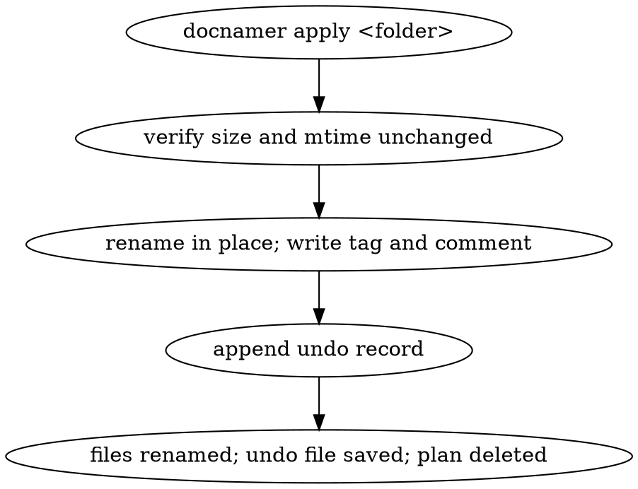
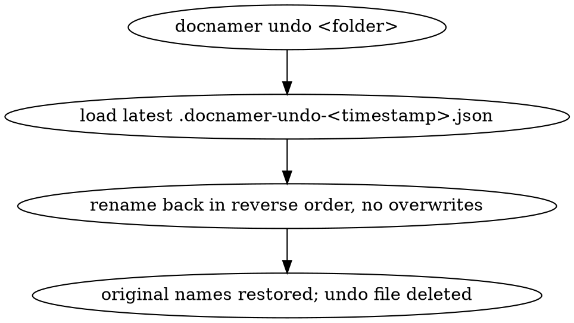
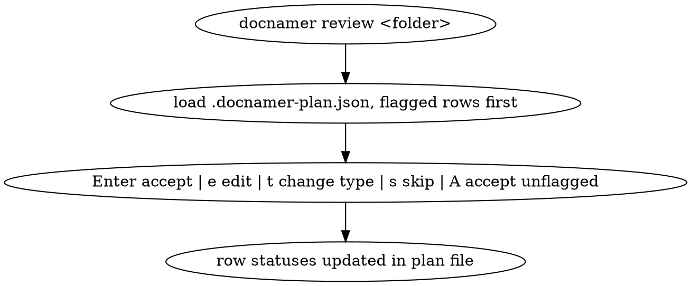
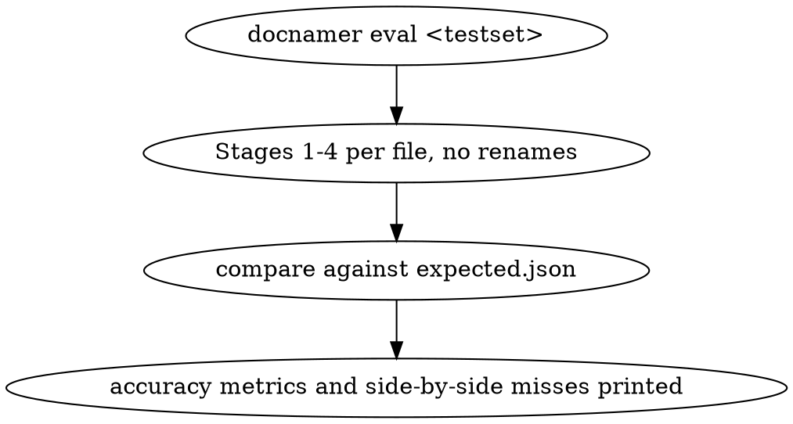

# 0003. An approved plan is applied with an undo record, and the whole thing installs as one binary

- Status: accepted
- Date: 2026-11-05

## Context

The second half of docnamer (0001): turning an approved plan (0002) into renamed files, with
something that puts them back, Spotlight metadata written the way macOS reads it, a small screen
for approving rows, a command that scores the pipeline against real documents, and the one
standalone binary the operator installs.

This feature begins where 0002 ends — `plan` working — and is the only place in the program that
mutates a file. Renaming is destructive when it is wrong, so the operator's requirement here was
not "rename" but "rename and be able to take it back until I am satisfied with it". That, and one
more: the deliverable is a single executable, "that i will install locally", so everything this
feature adds has to fit inside a bundled binary with no project checkout beside it.

Three constraints come from 0001 and are binding: Bun's own APIs for the work, a `node:` built-in
only where Bun has no equivalent, the CLI subprocess as the only surface, and model calls through
`@earendil-works/pi-ai`.

Four things the machine settled rather than the design. The install path is `~/bin` — plain, not
chezmoi-managed — because `~/.local/bin` is tracked and a build output there would become a dotfile.
The `tag` binary is not installed, so a Finder tag is written straight to the file's user-tags
attribute as a binary plist. A Finder comment is written through Finder itself, which is slow, so
it stays off by default. A searchable text layer for scans exists (`mac-ocr searchable-pdf`) and
rewrites the original, so it is off by default too.

## Decision

`review` approves rows, `apply` renames the approved ones and records what it did, `undo` puts the
names back, `eval` scores the pipeline without renaming anything, and `bun run build` leaves one
standalone binary at `~/bin/docnamer`.

- R1: A single self-contained executable, produced by `bun build --compile`, installed at `~/bin`,
  running with no project checkout on disk and with its documents, its OCR binary and its config
  all reached from inside the binary.
- R2: `apply <folder>` renames each accepted plan row in place to its new name, writes the type's
  Finder tag and its comment when that is enabled, records every change in the undo file, and
  deletes the plan file.
- R3: Every apply run keeps an undo record at `<folder>/.docnamer-undo-<timestamp>.json` so the
  changes can be reversed until the operator is satisfied. `undo <folder>` restores the original
  names of the latest run (or a named one) in reverse order, skipping and reporting any entry whose
  file changed since, and never overwriting an occupied name.
- R4: `review <folder>` shows each plan row with its old name, new name, type, flags, quotes and
  summary; Enter accepts, `e` edits the name, `t` changes the type and rebuilds the name, `s`
  skips, and `A` accepts every unflagged row while flagged rows stay pending. Row statuses are
  written back to the plan file.
- R5: A searchable text layer for a scanned PDF is written by `mac-ocr searchable-pdf`, replacing
  the original so Spotlight indexes the page text. Off by default; when it runs, the rewritten file
  is covered by the same undo record as the rename, and `undo` restores the bytes from before.
- R6: Spotlight extras: a Finder tag per type, written directly to the file's user-tags attribute
  as a binary plist, on by default; a Finder comment carrying the row's summary, off by default.
- R7: Apply skips and reports any file whose size or modification time changed since the plan was
  written, and never renames a row the operator did not accept.
- R8: `eval <testset>` runs the pipeline's four stages against a folder of files and an expected
  list, renaming nothing, and prints type accuracy, per-field exact match, full-name match, the
  share of files that needed the vision model, and time and cost per file, with each miss shown
  side by side with its quotes.

### I1: Apply accepted rows with backup

- Outcome: `docnamer apply <folder>` renames each accepted row in place to its new name, writes the
  type's Finder tag (and comment when enabled), records every change in
  `<folder>/.docnamer-undo-<timestamp>.json`, deletes the plan file, and skips-with-report any file
  whose size or mtime changed since planning.

### I2: Undo a run

- Outcome: `docnamer undo <folder>` restores every file renamed by the latest run to its original
  name, skipping and reporting any entry whose new name is missing or whose old name is occupied —
  it never removes or rewrites the file already sitting there. The undo file is deleted once every
  entry is back; one holding only the entries that could not go home stays, so the next undo can
  finish them.

### I3: Review and accept plan rows

- Outcome: `docnamer review <folder>` presents each plan row with old name, new name, type, flags,
  evidence and summary; accepting, editing, re-typing or skipping a row updates its status in the
  plan file, and "accept all unflagged" marks every flag-free row accepted while flagged rows stay
  pending.

### I4: Score a test set with eval

- Outcome: `docnamer eval <testset>` runs Stages 1–4 against the test set without renaming anything
  and prints type accuracy, per-field exact match, full-name match, share of files needing vision,
  and time/cost per file, with each miss shown as expected vs got alongside its evidence.

## Alternatives considered

- A backup directory of copied files, or a move-into-a-trash-folder strategy, instead of a record
  that reverses each rename — rejected: a copy doubles the disk a folder costs, and a reversal that
  records what it changed needs no space when nothing but the name was touched.
- Writing the undo record only, with no bytes stored, and accepting that an optional OCR rewrite
  cannot be reversed — rejected: the rewrite replaces the operator's original file, so the record
  names a sidecar copy of those bytes and the record itself stays plain JSON.
- A `tag` binary from brew, the way macOS tools usually do it — rejected: `tag` is not installed,
  and the attribute is writable directly, so a dependency and an install step are avoided.
- Writing the Finder comment always, because Spotlight searches it — rejected as the default:
  writing a comment is one Finder AppleScript call per file, slow enough that it is a choice.
- A full-screen interactive interface, or a new TUI framework, for review — rejected: the review
  screen is a list of rows and a handful of keys, which the terminal library this program already
  uses covers, and a framework would be a dependency for one screen.
- Applying rows without checking that the file is still the one that was planned — rejected: a
  file edited or replaced between planning and applying would be renamed on stale evidence.
- Treating the undo record as a permanent log — rejected: it is one run's, and its deletion is how
  the operator says the rename is settled.

## Consequences

- The operator's loop is plan, review, apply, and undo when a name is wrong — with the files, the
  names and the folder entirely his between each step.
- One binary, installed once, with the only external expectations being the macOS frameworks it
  calls and the provider key it needs. No checkout, no runtime, no dependencies.
- Cost and accuracy become measurable rather than felt: `eval` on real documents is the answer to
  "is a change to the roster or the descriptions an improvement?", and it renames nothing.
- Spotlight is the search surface, and its two extras are ordinary macOS metadata — a tag, a
  comment, and optionally a text layer — so none of it needs docnamer to be read back.
- A folder that carries an undo record is a folder with an unfinished decision in it, which is why
  the record is deleted by `undo` rather than pruned by a schedule.
