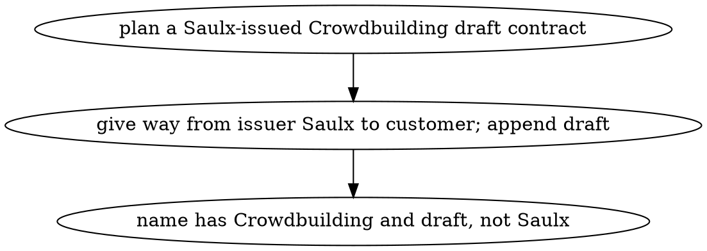
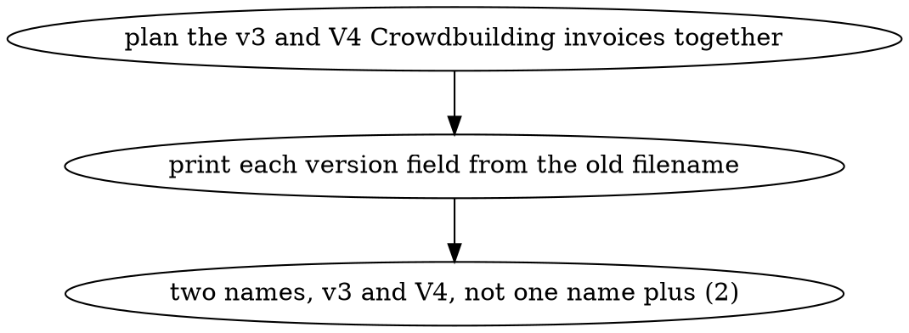
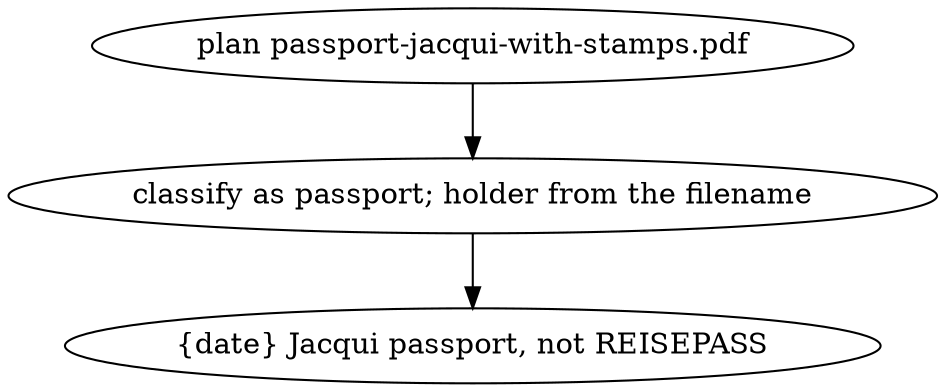
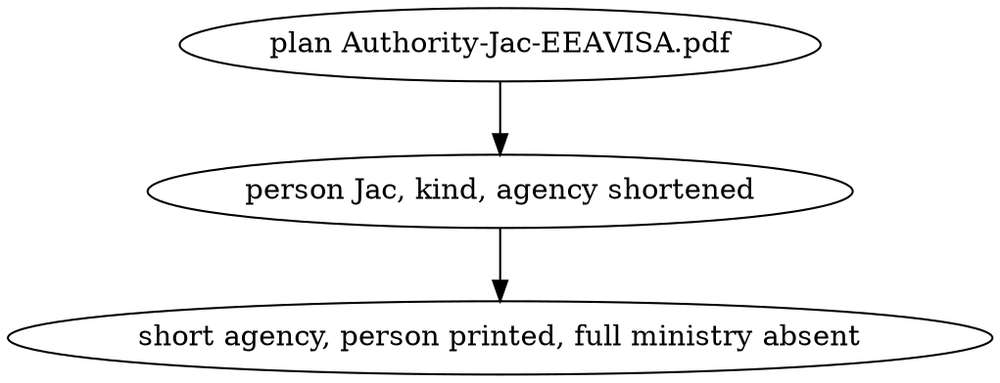
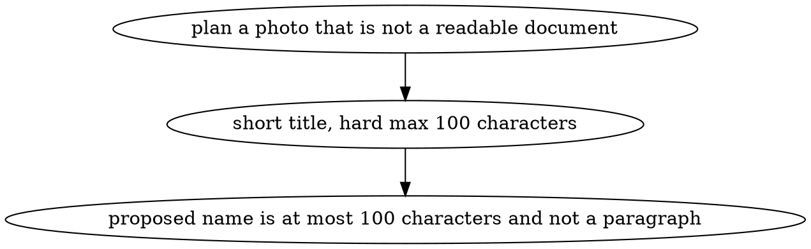
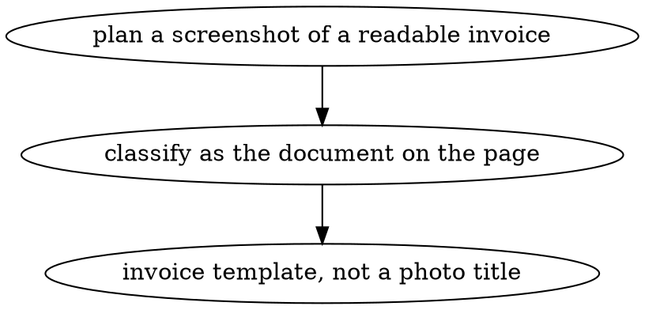
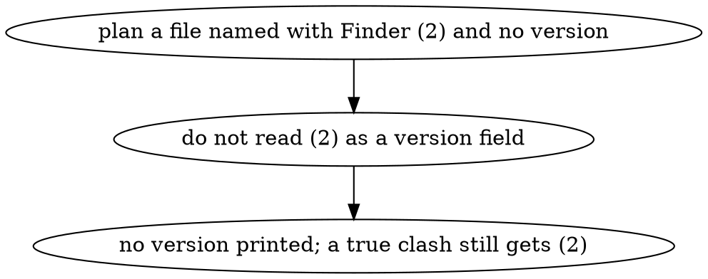

# 0004. Who is named, which tokens are printed, and how long a name may be are settled rules

- Status: accepted
- Date: 2026-11-05

## Context

The operator wrote out, in his own plan table, the naming rules he wanted when `docnamer plan`
proposes a filename. They are not preferences to be inferred: each one comes from a name the
pipeline produced that was wrong in a way he had to fix by hand — an invoice he issued named after
his own company instead of the customer, a passport named `REISEPASS`, a government letter carrying
a ministry's full title, a photo named with a paragraph, two versions of the same invoice collapsed
into one name plus a Finder ` (2)`.

The old filename already goes to the model (0002), which is why a token that only the filename
states can be recovered at all. But the last word on who is named, which tokens are printed and how
long the result may be belongs to code, not to the model: a model that silently drops `v3` is the
exact failure the plan table names.

This decision changes the config's self list, types, fields and templates, the words the model is
given, and the step that renders a name. It changes nothing about apply, undo or the review screen.

## Decision

- R1: The config's `self` list holds Knosey, Once, Saulx and the alias Saulx B.V. An invoice or a
  contract whose issuer or issuing party is self is named after the customer, never after us.
- R2: Version (`v3`, `V4`), status (`draft`) and a person token (`Jac`, `Jacqui`, `TM`) are their
  own fields. When the page does not state them and the old filename does, the plan prints them. A
  Finder collision suffix ` (2)` is not a version and is never copied into a version field.
- R3: Passport is its own type with the template `{date} {holder} passport` — the English word
  `passport`, never a foreign word printed on the page such as `REISEPASS`.
- R4: A government letter is named `{date} {person} {kind} {agency}`, where `agency` is a short name
  (IND), never the full ministry title (Immigration And Naturalisation Service, Ministry Of Justice
  And Security).
- R5: A photo or other non-document gets a short, clear title of about six words — never a paragraph
  — and a proposed filename of at most 100 characters. A screenshot of a readable document is
  classified and named as that document's type, not as a photo.
- R6: `defaults.max_name_length` stays 120. Names shorten to 120 by cutting subject and number
  first; the date, the named party, the type word, the version, the status and the person stay whole
  when they fit.
- R7: A contract is named `{date} contract {customer} {subject}`, with draft and version appended
  when present, and with the same issuer-gives-way-to-customer rule as an invoice.

The operator's five recorded decisions, each now a requirement above:

- D1 (2026-10-23): Self is Knosey, Once, Saulx and Saulx B.V.; issued invoices and contracts are
  named after the customer. Shapes R1 and R7.
- D2 (2026-10-23): Version, status and person are fields, taken from the old filename when the page
  is silent, and printed; Finder ` (2)` is a collision, not a version. Shapes R2.
- D3 (2026-10-23): Passport is `{date} {holder} passport`; a government letter is
  `{date} {person} {kind} {agency}` with a short agency. Shapes R3 and R4.
- D4 (2026-10-23): Photos and other non-documents get a short title, about six words, hard max 100
  characters; a screenshot of a readable document keeps that document's type; the global cap stays
  120. Shapes R5 and R6.
- D5 (2026-10-23): A contract is `{date} contract {customer} {subject}`, draft and version
  appended, same give-way as an invoice. Shapes R7.

### I1: issued contract named after the customer

- Outcome: planning `20260217 - Contract - Based Platform - Crowdbuilding (draft).pdf` proposes a
  name that contains the date, `contract`, `Crowdbuilding`, a subject, and `draft`, and does not
  contain `Saulx`.

### I2: invoice versions stay distinct

- Outcome: planning `20260006 Crowdbuilding February v3.pdf` and `20260006 Crowdbuilding V4.pdf`
  together proposes two invoice names that print `v3` and `V4`, and neither name is the other plus
  only ` (2)`.

### I3: passport named in English with the holder

- Outcome: planning `passport-jacqui-with-stamps.pdf` proposes a name of the form
  `{date} Jacqui passport` plus the extension, and the name does not contain `REISEPASS`.

### I4: government letter uses a short agency

- Outcome: planning `Authority-Jac-EEAVISA.pdf` proposes `{date} Jac {kind} {short agency}`, and the
  name does not contain `Immigration And Naturalisation Service` or
  `Ministry Of Justice And Security`.

### I5: photo title stays short

- Outcome: planning a photo that is not a readable document proposes a filename of at most 100
  characters whose title is about six words, not a paragraph.

### I6: screenshot of a document keeps that type

- Outcome: planning a screenshot whose page is a readable invoice proposes an invoice name from the
  invoice template, not a photo title and not type `other`.

### I7: Finder collision suffix is not a version

- Outcome: planning a file whose old name ends in ` (2)` and states no version proposes a name with
  no version field; a second file that renders that same name still receives a Finder ` (2)`
  collision suffix.

## Alternatives considered

- Putting version, status and person only in the model's words and trusting the template to print
  them — rejected as the only control: the failure the plan table names is a model that drops `v3`,
  so code must print a token the page omitted.
- Treating Finder ` (2)` as a version so two files stay distinct — rejected: it is a collision
  suffix, and the plan table forbids using it in place of `v3` and `V4`.
- Raising `max_name_length` to the spec example of 150 so long ministry names fit — rejected: the
  operator's cap stays 120 and the agency is shortened instead. The spec's JSON example is not
  authority; his number is.
- Keeping a passport inside `other`, or inside a generic ID type — rejected: he named a passport
  template, and `REISEPASS` is the failure that template prevents.
- Naming an invoice after whoever issued it, with no idea of "self" — rejected: an invoice he sent
  would be filed under his own company rather than the customer's.

## Consequences

- The config, not the model, decides who a document is named after, so a name that is wrong is
  wrong in one place and fixable in one place.
- A person, a version and a status survive a page that states none of them, which only works because
  the old filename is sent with the page — a renamed file loses that source and says so by planning
  without those tokens.
- The name is checkable: at most 100 characters for a photo, at most 120 otherwise, no full ministry
  title, no `REISEPASS`. "About six words" is the one rule only the model can honour, and it is the
  one the operator would notice as a sentence under the cap.
- A passport and a government letter now have their own types, so a roster edit is enough to change
  them, and no code change is needed to add the next one.
- The remaining risk is a short person token that happens to match a vendor or a subject: it would
  be printed as a person. The visible symptom is a person slot holding something that is not a name.

## Operator decisions

<!-- record:decisions -->
- plan · run `ship-feature-c8c792` · asked: When a government-letter agency is not Immigration And Naturalisation Service, how should the planned name shorten it? — answered: in the operator's words: cant you search for the abreviation?
<!-- /record:decisions -->
