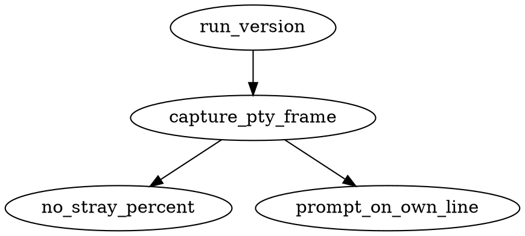
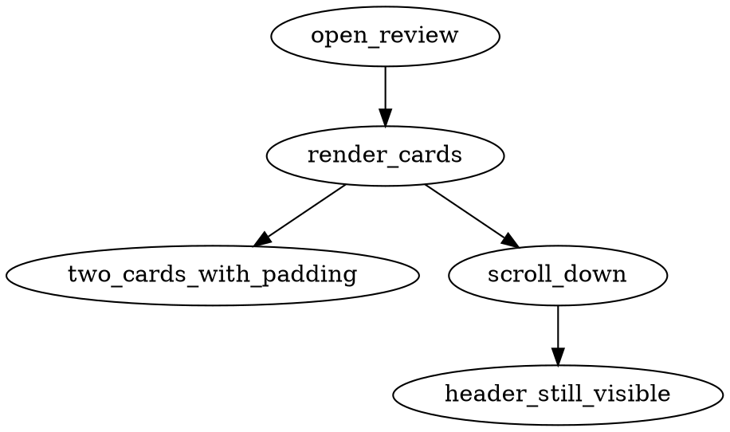
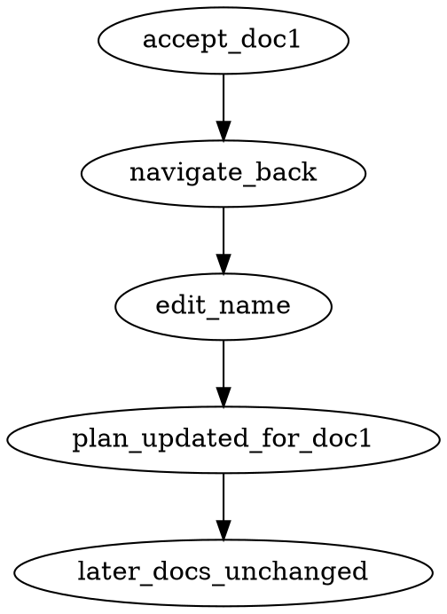
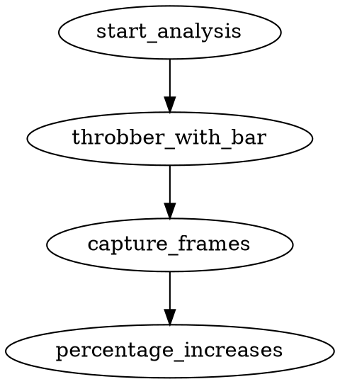
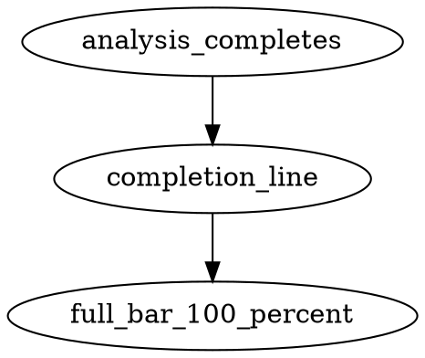
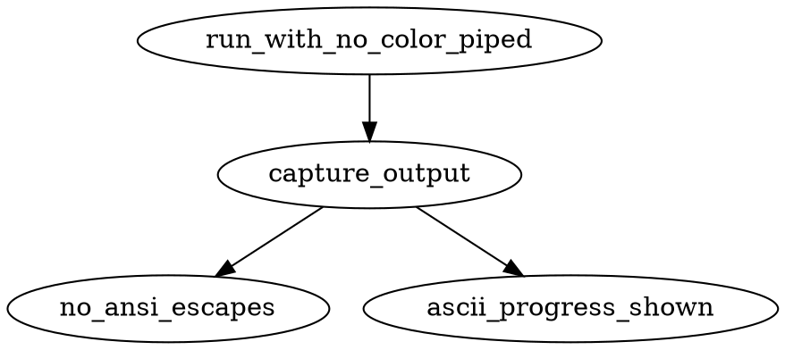

# 0005. The screen is usable by a ten-year-old and the shell is left clean

- Status: accepted
- Date: 2026-11-05

## Context

The program worked and felt wrong to use. The operator brought four things, in his words: a stray
`%` printed after `docnamer --version`; a review screen to redesign around the document itself, with
the controls always visible; a block progress bar next to the throbber; and plainer wording
throughout. His standard for the first is a ten-year-old being able to use it, and "as nice as an Ink
app, without using Ink".

The stray `%` is the one that is actually a defect rather than taste: the installer's shell wrapper
puts the terminal into raw mode for the interactive screen, and zsh prints its partial-line marker
when a command leaves the cursor mid-line with raw mode still on. So the fix is in the wrapper's
handling of the terminal, and it must not break the key handling the review screen depends on.

The review screen's problem was that it showed one document filling the viewport, so the operator
could not see the shape of the batch, and the controls scrolled away. He chose stacked, padded cards
in a scrollable list, with the proposed name and the quotes as each card's focus — and, asked how
much he might need to go back, he said he wanted to re-open documents he had already assessed and
change them: "I complete the first 10 and a the…", the eleventh clashing with the third.

## Decision

- R1: Running `docnamer --version`, and every other non-interactive command, leaves the terminal
  clean: output ends with a newline, no stray `%` appears, and no raw mode is left behind. The
  wrapper restores the terminal before exiting.
- R2: The review screen shows several documents at once as visually padded cards in a scrollable
  list, with the document itself — its proposed name and its quotes — as each card's focus.
- R3: The review controls (accept, edit, skip, quit, and the position, such as `3/12`) sit in a
  locked header that does not scroll away.
- R4: Any already-assessed document can be re-opened and changed — after finishing documents 1 to
  10, document 3 can be renamed again, and the remaining work continues from where it was.
- R5: While documents are analysed, a block progress bar of the form `▰▰▰▰▱▱▱▱▱▱ 45%` renders next to
  the existing throbber and advances as documents complete.
- R6: The same block-bar style reports completion status — review or apply progress — wherever a
  fraction complete is already known.
- R7: Every user-visible string — prompt, error, help text — is plain English a ten-year-old can
  read. Command and flag names are unchanged.
- R8: Unicode (`▰▱`, box drawing) and colour are used where the terminal supports them, with an
  automatic fallback to plain ASCII and no colour when the environment or a non-terminal output
  says otherwise.

The operator's recorded answers, which settled the open questions in this feature:

- D1: Several padded cards stacked in a list, not one document filling the viewport, plus the
  ability to re-open and change already-assessed documents. Shapes R2 and R4.
- D2: Plain wording applies to strings only; command and flag names are unchanged. Shapes R7.
- D3: Unicode and colour, with an ASCII fallback. Shapes R8, kept even after he called the fallback
  a ridiculous edge case: it works or it is not used, and the fallback is what makes "it works"
  true on a terminal that cannot draw the bar.
- D4: A name clash found when re-editing an earlier document is re-checked on that edit and blocks
  the save, rather than being discovered at apply time. Shapes R4.

### I1: version command leaves a clean terminal

- Outcome: `docnamer --version` run under zsh in a real pty prints the version line and the shell
  prompt returns on the next line with no stray `%` marker and the tty back in cooked mode.

### I2: review screen shows padded cards with a locked controls header

- Outcome: A captured review frame shows at least two document cards with visible padding between
  them, and the controls header (accept / edit / skip / quit plus position) is present even after
  scrolling down the list.

### I3: revisit and change an already-assessed document

- Outcome: The user accepts document 1 of several, navigates back to it, edits its proposed name,
  and the plan file on disk records the new name for that document while later documents keep their
  prior state.

### I4: block progress bar next to the throbber during analysis

- Outcome: Captured frames of the analysis phase show a `▰`/`▱` block bar followed by a percentage
  beside the throbber, and the percentage increases monotonically as documents complete.

### I5: completion status uses the same block bar

- Outcome: When analysis (or review/apply) finishes, the completion line shows the full bar
  `▰▰▰▰▰▰▰▰▰▰ 100%` in the same format as the in-progress bars.

### I6: ASCII and no-colour fallback

- Outcome: With `NO_COLOR=1` and stdout piped (not a tty), command output contains no ANSI escape
  sequences and no `▰`, `▱` or box-drawing characters; progress is shown with ASCII characters
  instead.

## Alternatives considered

- One document filling the viewport, scrolling between them — the first design, and the one the
  operator rejected: it hides the batch and puts the controls at the mercy of scroll position.
- Renaming commands and flags while rewriting the wording — rejected: strings only, names unchanged,
  so nothing scripted or remembered breaks.
- Ink, or another TUI framework, for the layout — rejected: the program already draws its screen with
  the terminal library it depends on, and a framework would be a dependency for one screen.
- A bar that is only unicode, with no fallback — rejected: the operator wants it to work or not be
  used, and the fallback is what keeps a piped or plain terminal readable.
- Fixing the stray `%` by making the wrapper always allocate no tty, or by leaving the shell to cope
  — rejected: it hides the symptom on one shell and breaks the interactive screen everywhere.
- Detecting a clash only when applying — rejected: the operator's own example is the eleventh
  document clashing with the third, which is a review-time problem, not an apply-time one.

## Consequences

- The batch is visible while it is being reviewed, and the keys never move, so the screen can be read
  in two glances: the cards, and the header.
- Going back is free — an earlier document can be renamed after ten others were assessed — at the
  cost of re-checking that name against the rest of the plan on the edit.
- Progress stops being a spinner with no end: the bar says how much of the work is done, in the same
  shape while running and when finished.
- The wrapper's terminal handling becomes load-bearing for two different behaviours: the clean exit
  of a non-interactive command, and the key handling of the interactive one. A change to one is felt
  by the other.
- On a terminal that cannot draw the bar, or when output is piped, the same information appears in
  ASCII — so the bar is a nicety and never the only report of progress.

## Operator decisions

<!-- record:decisions -->
- brainstorm · run `brainstorm-design-9b4e5a` · asked: Review screen: with controls locked as a header, how should each document be laid out — one document filling the viewport (scroll between docs), or several padded cards stacked in a list? — answered: in the operator's words: 2 and I want to be able to reselect and version already assessed and change, for example I complete the first 10 and a the… [+95 chars]
- brainstorm · run `brainstorm-design-9b4e5a` · asked: Plainer wording: how far should it go — only user-visible strings (prompts, errors, help), or also command names and flags? — answered: Strings only, names unchanged (Recommended)
- brainstorm · run `brainstorm-design-9b4e5a` · asked: How much may the UI depend on terminal features — is plain ANSI colour/box-drawing on any modern terminal enough, or must everything degrade gracefully to plain ASCII (no unicode ▰▱, no colour)? — answered: Unicode+colour with ASCII fallback (Recommended)
- plan · run `ship-feature-18a5f1` · asked: After the user goes back and changes an already-assessed document's name (R4), when should name-clash checks against later documents re-run? The BRIEF lists this as an open risk and the workplan's T5 does not define it. — answered: Re-check on edit, block clashing save (Recommended)
- plan · run `ship-feature-8d7ad3` · asked: When must block-drawing glyphs fall back to ASCII? R8, AC6, I6 and workplan T3 say a non-tty or NO_COLOR forces ASCII; the workplan global unicode rule only checks TERM and utf8. — answered: in the operator's words: this is a rediculous edge case, it works or its not used simple
- plan · run `ship-feature-d9d35a` · asked: The written plan still requires ASCII and no-colour fallback (R8, AC6, I6, styleFrom). You later called that edge case ridiculous and said it works or it is not used. Which rule should the plan follow? — answered: Keep R8 ASCII fallback (Recommended)
<!-- /record:decisions -->
