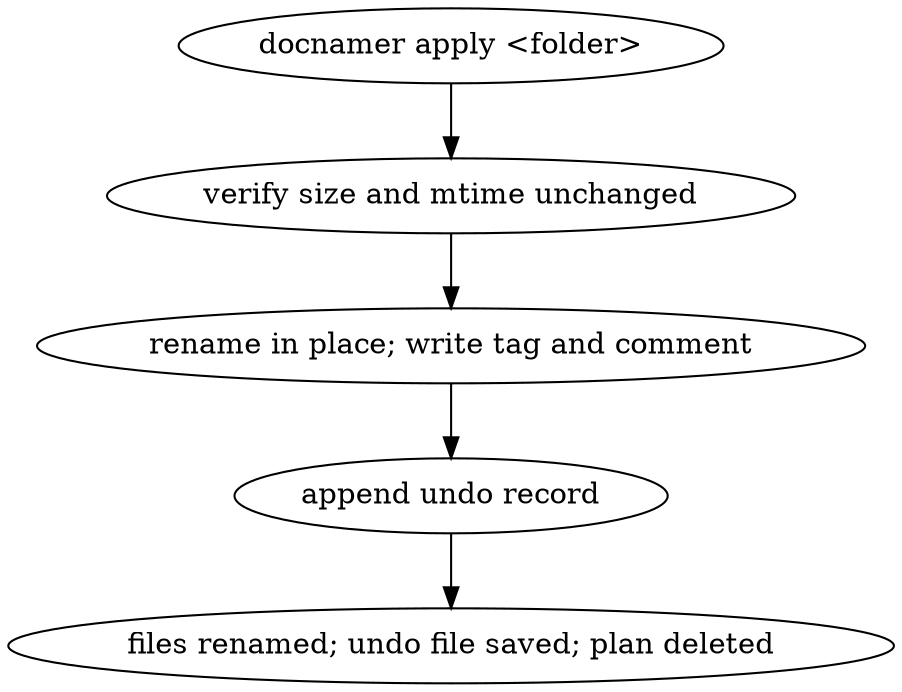
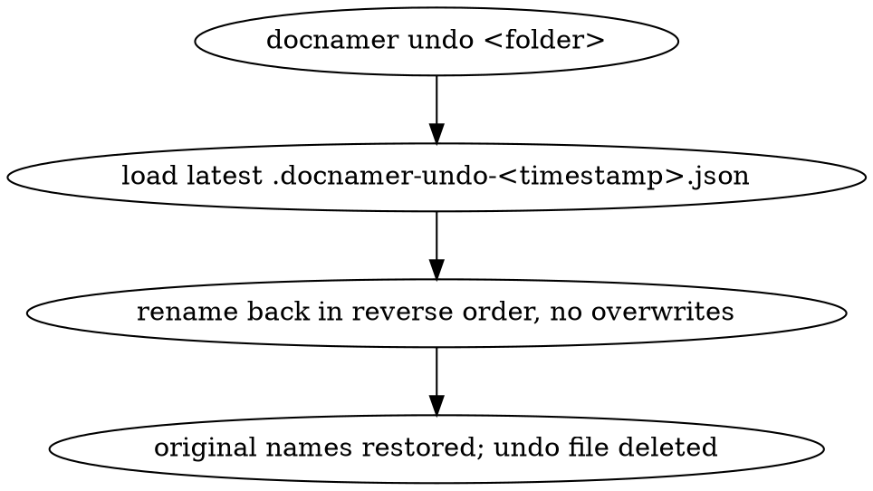
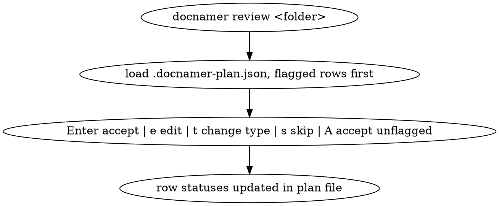
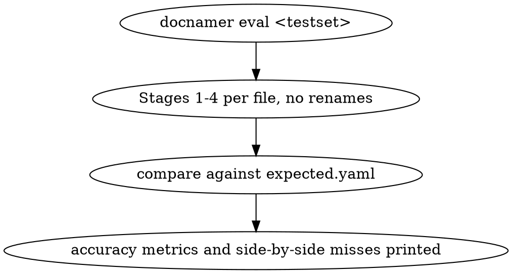

# INTERACTIONS: doc-renamer-apply

## I1: Apply accepted rows with backup
- Outcome: `docnamer apply <folder>` renames each accepted row in place to its new
  name, writes the type's Finder tag (and comment when enabled), records every
  change in `<folder>/.docnamer-undo-<timestamp>.json`, deletes the plan file, and
  skips-with-report any file whose size or mtime changed since planning.

## I2: Undo a run
- Outcome: `docnamer undo <folder>` restores every file renamed by the latest run
  to its original name (skipping and reporting any entry whose new name is missing
  or whose old name is occupied) and deletes that undo file.

## I3: Review and accept plan rows
- Outcome: `docnamer review <folder>` presents each plan row with old name, new
  name, type, flags, evidence and summary; accepting, editing, re-typing or
  skipping a row updates its status in the plan file, and "accept all unflagged"
  marks every flag-free row accepted while flagged rows stay pending.

## I4: Score a test set with eval
- Outcome: `docnamer eval <testset>` runs Stages 1–4 against the test set without
  renaming anything and prints type accuracy, per-field exact match, full-name
  match, share of files needing vision, and time/cost per file, with each miss
  shown as expected vs got alongside its evidence.

