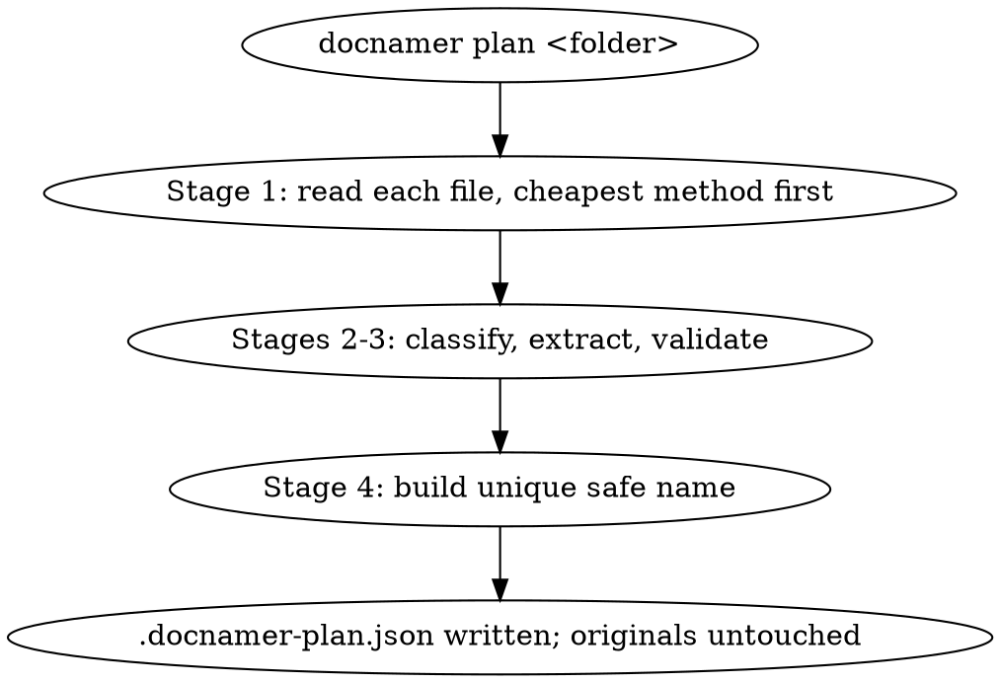
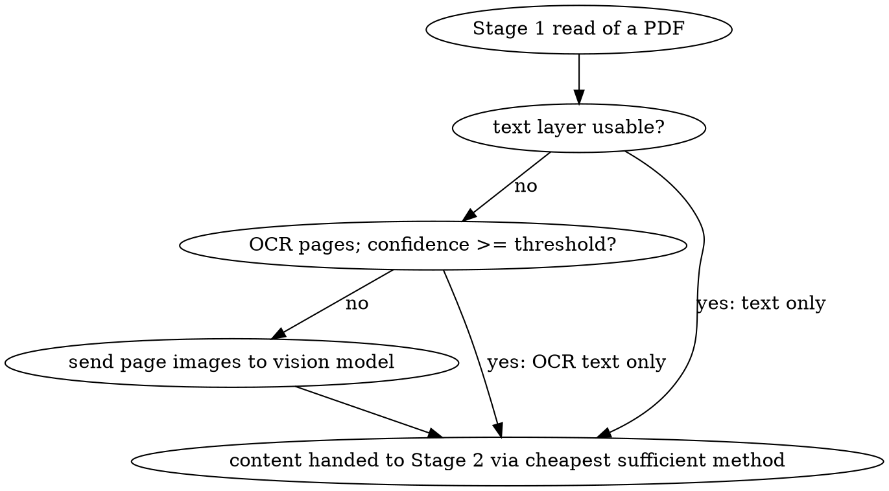
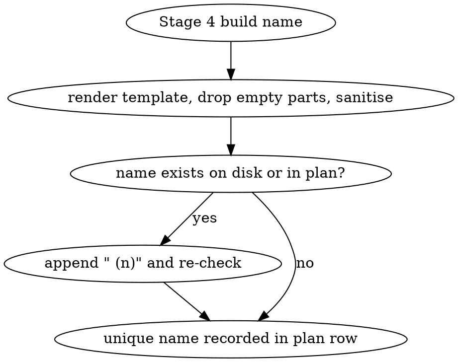

# INTERACTIONS: doc-renamer-pipeline

## I1: Plan a folder of documents without touching files
- Outcome: running `docnamer plan <folder>` on a folder of mixed documents writes
  `<folder>/.docnamer-plan.json` containing a row per file with old name, proposed
  new name, type, fields, evidence quotes, flags, summary, size, mtime and status
  "pending", prints the old→new table with flagged rows first, and leaves every
  original file's name, size and mtime unchanged.

## I2: Vision fallback only when OCR is weak
- Outcome: for a scanned PDF whose OCR text is under the confidence threshold, the
  plan row is produced from a vision-model call over page images, while a PDF with
  a usable text layer is planned from text alone with no image sent to the model.

## I3: Collision-safe unique naming
- Outcome: when two documents in the same folder (or one document and an existing
  file) produce the same rendered name, the later plan row receives a Finder-style
  ` (2)` suffix, and no plan row ever proposes a name already occupied on disk.

