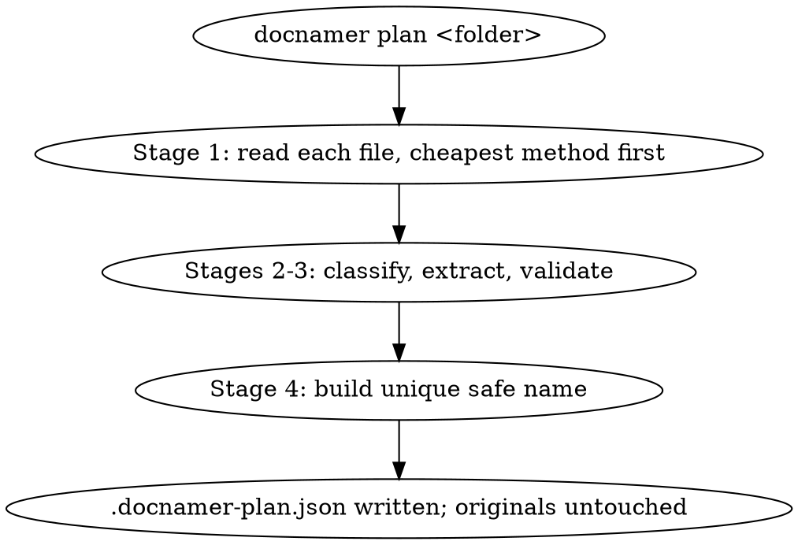
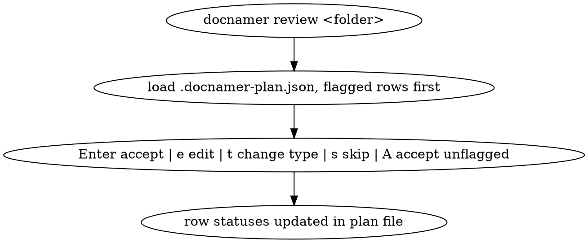
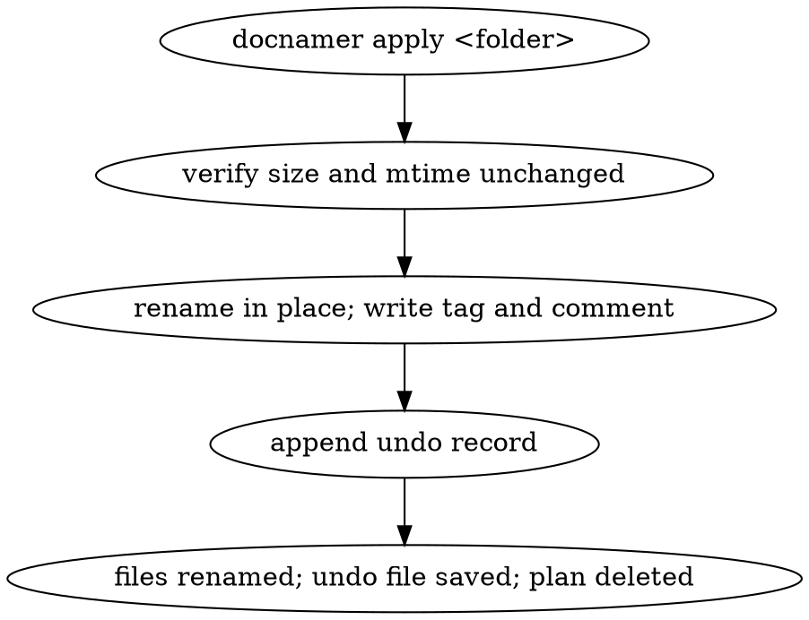
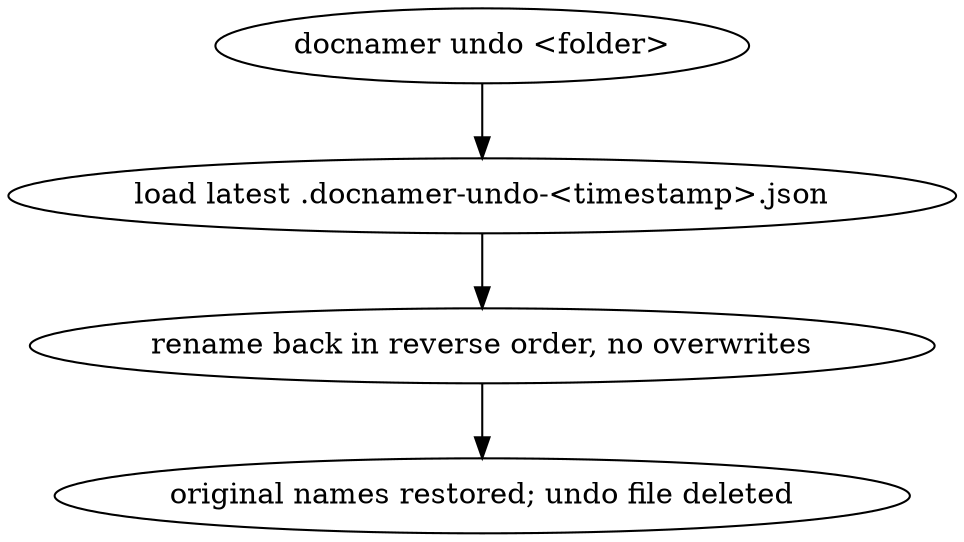
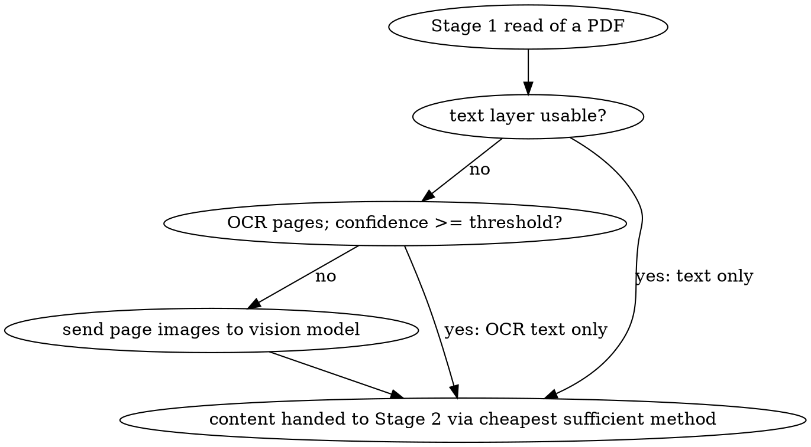
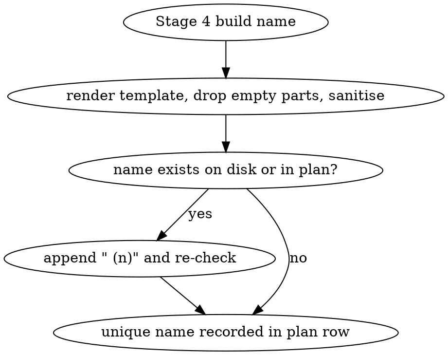
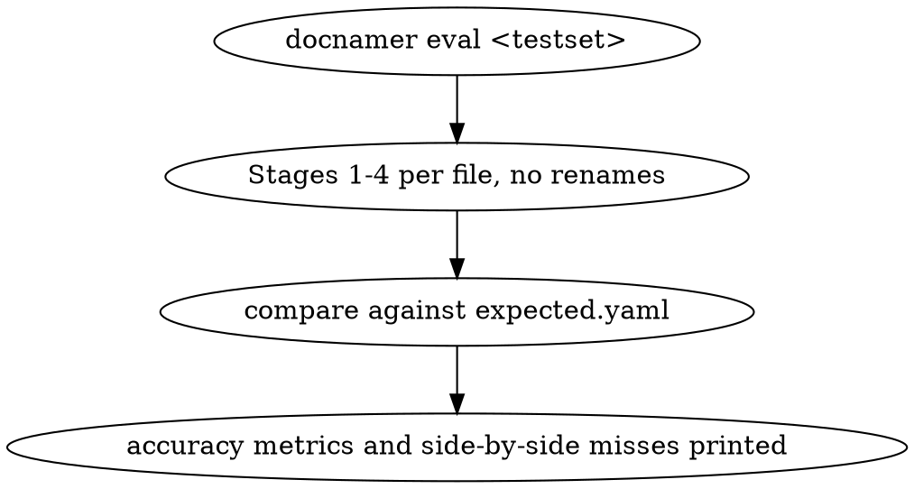

# INTERACTIONS: doc-renamer

## I1: Plan a folder of documents without touching files
- Outcome: running `docnamer plan <folder>` on a folder of mixed documents writes
  `<folder>/.docnamer-plan.json` containing a row per file with old name, proposed
  new name, type, fields, evidence quotes, flags, size, mtime and status
  "pending", prints the old→new table with flagged rows first, and leaves every
  original file's name, size and mtime unchanged.

## I2: Review and accept plan rows
- Outcome: `docnamer review <folder>` presents each plan row with old name, new
  name, type, flags and evidence; accepting, editing, re-typing or skipping a row
  updates its status in the plan file, and "accept all unflagged" marks every
  flag-free row accepted while flagged rows stay pending.

## I3: Apply accepted rows with backup
- Outcome: `docnamer apply <folder>` renames each accepted row in place to its new
  name, writes the type's Finder tag (and comment when enabled), records every
  change in `<folder>/.docnamer-undo-<timestamp>.json`, deletes the plan file, and
  skips-with-report any file whose size or mtime changed since planning.

## I4: Undo a run
- Outcome: `docnamer undo <folder>` restores every file renamed by the latest run
  to its original name (skipping and reporting any entry whose new name is missing
  or whose old name is occupied) and deletes that undo file.

## I5: Vision fallback only when OCR is weak
- Outcome: for a scanned PDF whose OCR text is under the confidence threshold, the
  plan row is produced from a vision-model call over page images, while a PDF with
  a usable text layer is planned from text alone with no image sent to the model.

## I6: Collision-safe unique naming
- Outcome: when two documents in the same folder (or one document and an existing
  file) produce the same rendered name, the later plan row receives a Finder-style
  ` (2)` suffix, and no apply ever overwrites an existing file.

## I7: Score a test set with eval
- Outcome: `docnamer eval <testset>` runs Stages 1–4 against the test set without
  renaming anything and prints type accuracy, per-field exact match, full-name
  match, share of files needing vision, and time/cost per file, with each miss
  shown as expected vs got alongside its evidence.

