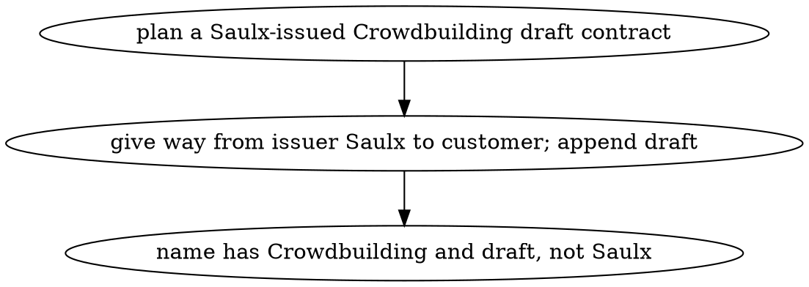
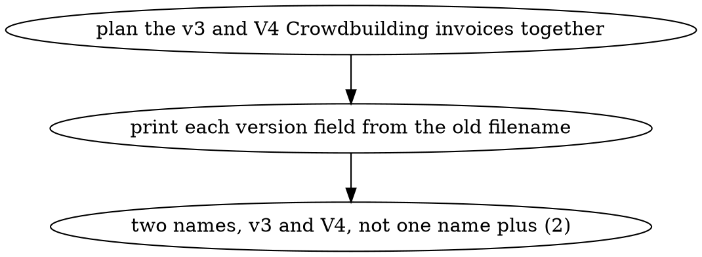
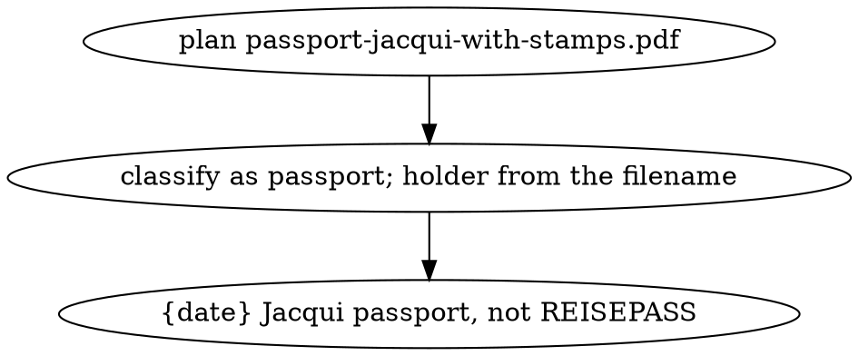
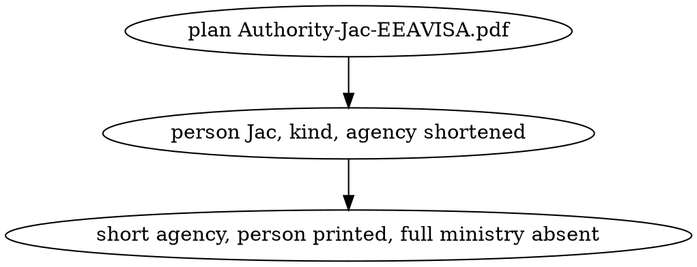
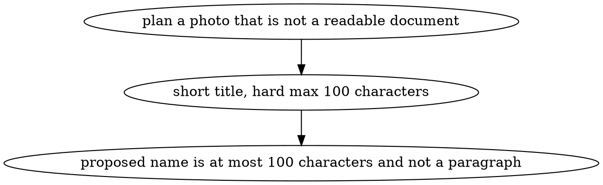
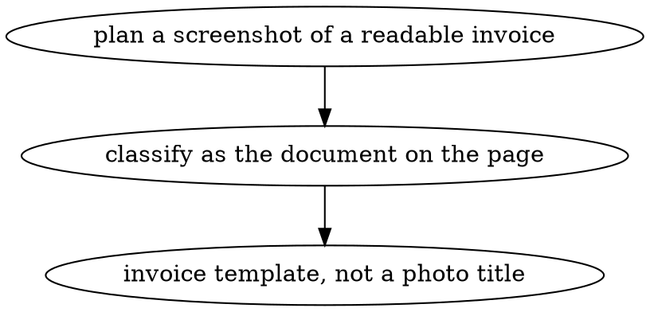
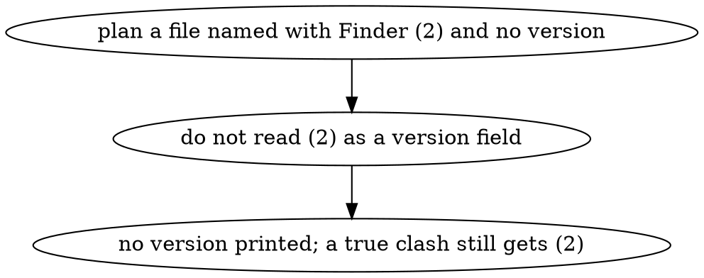

# INTERACTIONS: naming-rules

Each outcome is a plan row `docnamer plan` does not produce today. Nothing here is applied to disk.

## I1: issued contract named after the customer
- Outcome: planning `20260217 - Contract - Based Platform - Crowdbuilding (draft).pdf` proposes a name that contains the date, `contract`, `Crowdbuilding`, a subject, and `draft`, and does not contain `Saulx`.

## I2: invoice versions stay distinct
- Outcome: planning `20260006 Crowdbuilding February v3.pdf` and `20260006 Crowdbuilding V4.pdf` together proposes two invoice names that print `v3` and `V4`, and neither name is the other plus only ` (2)`.

## I3: passport named in English with the holder
- Outcome: planning `passport-jacqui-with-stamps.pdf` proposes a name of the form `{date} Jacqui passport` plus the extension, and the name does not contain `REISEPASS`.

## I4: government letter uses a short agency
- Outcome: planning `Authority-Jac-EEAVISA.pdf` proposes `{date} Jac {kind} {short agency}` and the name does not contain `Immigration And Naturalisation Service` or `Ministry Of Justice And Security`.

## I5: photo title stays short
- Outcome: planning a photo that is not a readable document proposes a filename of at most 100 characters whose title is about six words, not a paragraph.

## I6: screenshot of a document keeps that type
- Outcome: planning a screenshot whose page is a readable invoice proposes an invoice name from the invoice template, not a photo title and not type `other`.

## I7: Finder collision suffix is not a version
- Outcome: planning a file whose old name ends in ` (2)` and states no version proposes a name with no version field; a second file that renders that same name still receives a Finder ` (2)` collision suffix.

