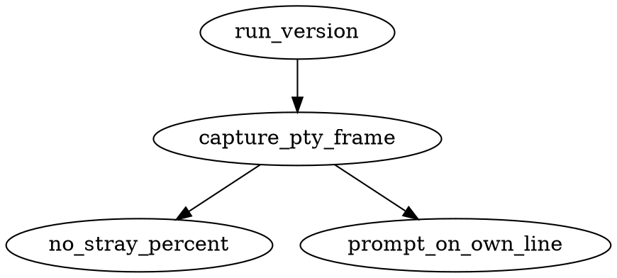
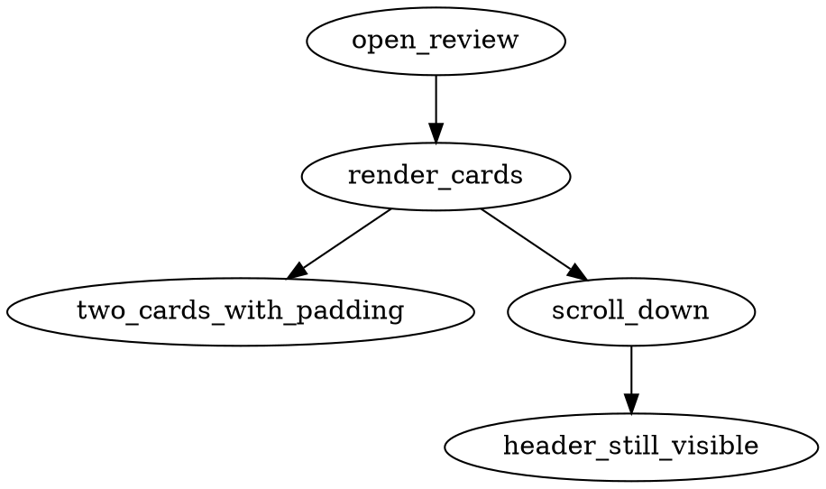
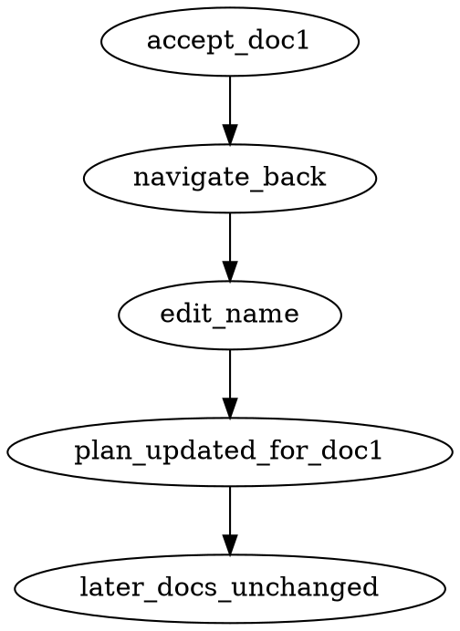
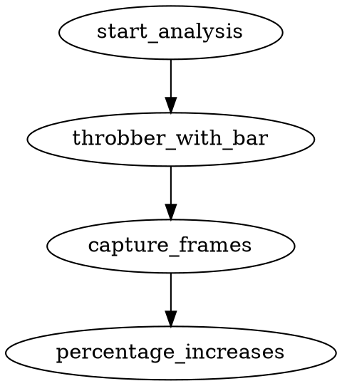
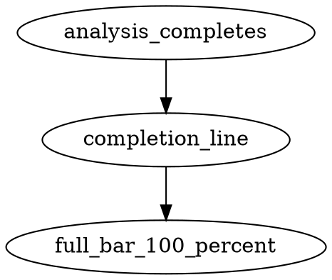
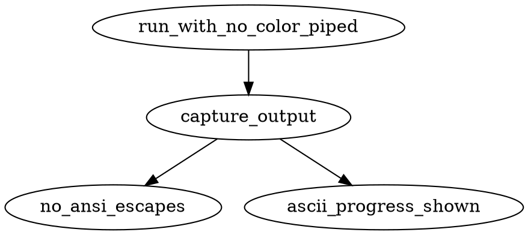

# INTERACTIONS: terminal-ux-polish

## I1: version command leaves a clean terminal
- Outcome: `docnamer --version` run under zsh in a real pty prints the
  version line and the shell prompt returns on the next line with no stray
  `%` marker and the tty back in cooked mode.

## I2: review screen shows padded cards with a locked controls header
- Outcome: A captured review frame shows at least two document cards with
  visible padding between them, and the controls header (accept / edit /
  skip / quit plus position) is present even after scrolling down the list.

## I3: revisit and change an already-assessed document
- Outcome: The user accepts document 1 of several, navigates back to it,
  edits its proposed name, and the plan file on disk records the new name
  for that document while later documents keep their prior state.

## I4: block progress bar next to the throbber during analysis
- Outcome: Captured frames of the analysis phase show a `▰`/`▱` block bar
  followed by a percentage beside the throbber, and the percentage increases
  monotonically as documents complete.

## I5: completion status uses the same block bar
- Outcome: When analysis (or review/apply) finishes, the completion line
  shows the full bar `▰▰▰▰▰▰▰▰▰▰ 100%` in the same format as the in-progress
  bars.

## I6: ASCII and no-colour fallback
- Outcome: With `NO_COLOR=1` and stdout piped (not a tty), command output
  contains no ANSI escape sequences and no `▰`, `▱` or box-drawing
  characters; progress is shown with ASCII characters instead.

